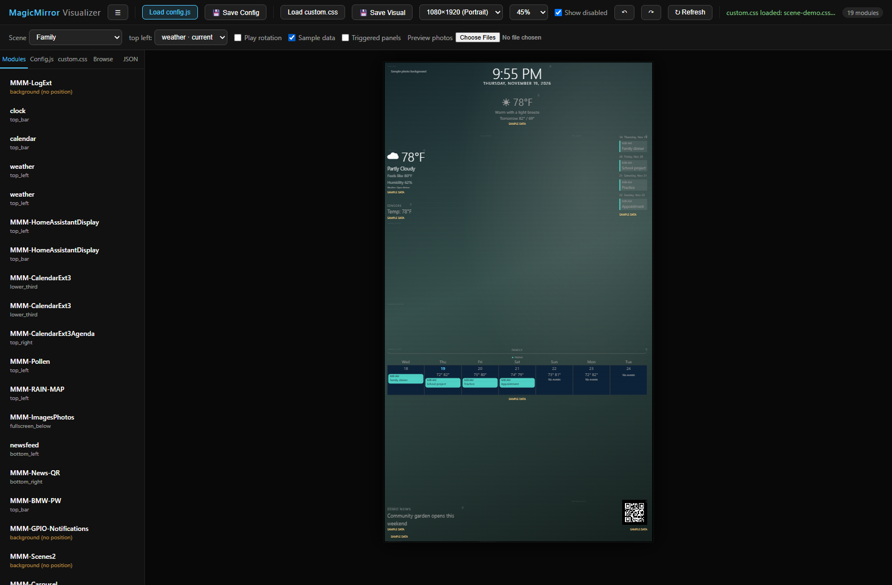
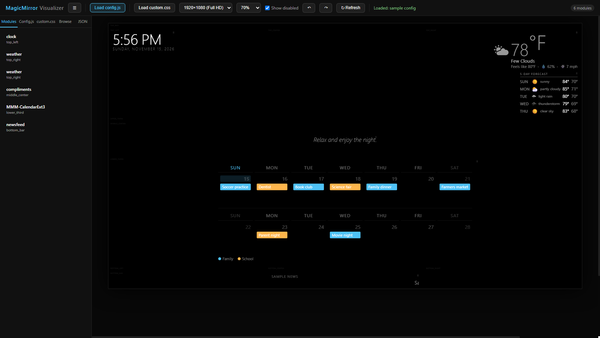
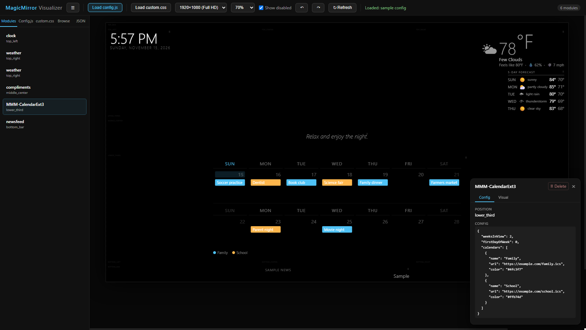

# MMVisualizer

A browser-based visual editor and live preview tool for [MagicMirror²](https://magicmirror.builders/) configurations. Design your mirror layout, tweak styling, and export ready-to-use config files — all without touching the Raspberry Pi.

---

## Screenshots

Scene/carousel example with explicit sample data (portrait preview):



Sample data (made-up weather, calendar events and headlines), 1920×1080 preview.



Click any module to open its detail panel (Config and Visual tabs):



---

## Features

- **Live mirror preview** — see your layout at real resolution (e.g. 1920×1080), scaled to fit your browser window
- **Load your own `Config.js`** — import an existing MagicMirror config and see it rendered instantly
- **Load `custom.css`** — load your MagicMirror style file directly to control colors, fonts, and spacing in the preview
- **Weather** — Open-Meteo current, hourly and daily forecasts without an API key, plus OpenWeatherMap current and daily previews
- **Calendars** — CalendarExt3 day/week/month and CalendarExt3Agenda, using named feeds from the built-in `calendar` module, including recurrence and feed-provided timezones
- **Scenes and rotation** — choose a Scenes2 scene and a Carousel panel, play/pause rotation, or show all modules while editing
- **Module previews** — Home Assistant templates, pollen, BMW-PW, local photos, radar and news QR, with clearly labelled sample data where live services are unavailable
- **Drag & drop between regions** — move modules between any of the 13 MagicMirror positions by dragging
- **Free positioning** — toggle "Free Position" on any module to place it anywhere on the mirror with pixel precision; exports the CSS override needed for the Pi
- **Resize handles** — drag the right edge, bottom edge, or corner of any module to resize it visually
- **Per-module Visual tab** — click any module to open a detail panel with its config fields and visual style controls (font size, cell height, width, etc.)
- **Module browser** — search GitHub for MagicMirror community modules and drag them directly into your layout
- **Save to file** — save changes back to your original `Config.js` and `custom.css` on disk (uses the File System Access API; falls back to download)
- **Delete modules** — select a module on the preview and press `Delete` to remove it
- **Undo / redo** — `Ctrl+Z` / `Ctrl+Shift+Z` (or the ↶ ↷ buttons) cover moves, deletes, adds and free-position changes
- **Shortcuts** — `Ctrl+S` save, `Delete` remove module, `Esc` close panel, arrow keys nudge a free-positioned module (`Shift` = 10px)
- **Unsaved-changes guard** — tab title shows `•` and the browser warns before closing with unsaved edits
- **Remembers your view** — resolution, zoom, show-disabled and sidebar state persist between sessions
- **Collapsible sidebar** — press ☰ to hide the sidebar and see the full mirror preview

---

## Quick Start

1. **Clone or download this repository**

   ```bash
   git clone https://github.com/jackel3415/MMVisualizer.git
   cd MMVisualizer
   ```

2. **Open `MMVisualizer.html` in your browser**

   No build step is required. Keep `preview-runtime.js`, `preview.css` and `vendor/` alongside the HTML file when downloading or copying it.

   > Chrome or Edge is recommended for full File System Access API support (save-to-file).  
   > Firefox works but will use download-only mode for saving.

3. **Load your config files** (optional)

   - Click **Load Config.js** and select your MagicMirror `Config.js`
   - Click **Load custom.css** and select your `MagicMirror/config/custom.css`

   If you don't have existing files, the visualizer loads with a built-in default config.

   For a scene-based example, load `examples/scene-demo.js` and `examples/scene-demo.css`, then enable **Sample data**. Select portrait resolution if the layout was designed for a portrait screen.

4. **Edit and preview**

   - Drag modules between regions
   - Click a module to edit its config and visual settings
   - Resize modules with the drag handles that appear on hover
   - Browse community modules via the **Browse** tab
   - Use **Scene** and the position dropdowns to inspect a scene or carousel panel; **Play rotation** uses the configured intervals
   - Enable **Sample data** for sanitized calendar feeds and service values; sample data never changes your exported config
   - Select **Preview photos** to load local images, or **Triggered panels** to inspect conditional Home Assistant displays

5. **Save your changes**

   - Click **Save Config.js** to write back to disk
   - Click **Save Visual** to write back to your `custom.css` on disk

---

## Files in This Repository

| File | Purpose |
|---|---|
| `MMVisualizer.html` | Application entry point — open this in your browser |
| `preview-runtime.js`, `preview.css` | Module previews, scene selection, native region geometry and stylesheet scoping |
| `vendor/` | Bundled iCalendar parser and QR encoder, with licenses; no CDN is required |
| `serve.py` | Optional local server for public calendar feeds that block browser CORS |
| `examples/scene-demo.*` | Made-up scene/carousel example, suitable for sample-data mode |
| `Config.sample.js` | Example MagicMirror config with placeholder values — copy to `Config.js` and fill in your own |
| `custom.css` | Visual style settings (colors, fonts, spacing) — mirrors the file MagicMirror reads on the Pi |
| `LICENSE` | MIT License |

---

## Setting Up Your Config

Copy `Config.sample.js` to `Config.js` and fill in your values:

```bash
cp Config.sample.js Config.js
```

Then edit `Config.js`:

- **Weather**: Replace `YOUR_OPENWEATHERMAP_API_KEY` with a free key from [openweathermap.org](https://openweathermap.org/api)
- **Calendar**: Replace `YOUR_ICAL_URL_HERE` with your calendar's iCal/webcal URL (Google Calendar, iCloud, etc.)
- **Location**: Update `location` in the weather modules to your city

> `Config.js` is listed in `.gitignore` so your API keys and private calendar URLs are never committed.

---

## custom.css Reference

`custom.css` is the same file MagicMirror reads on the Pi. Load it into the visualizer to preview your styles, edit via the Visual tab, and save it back — no extra conversion step needed.

Ordinary selectors work even without any known CSS variables. `body` rules target the preview body, `.region.top.left` and `.module-header` match the native-style preview markup, and rules are scoped individually so a malformed brace cannot expose the editor UI to later selectors. Unmatched closing braces are repaired on import and reported in the status line. Keep your original file when reviewing a repair. `@font-face` is supported; external `@import` rules are skipped.

| CSS Variable | Default | Description |
|---|---|---|
| `--color-text` | `#999` | Default module text color |
| `--color-text-dimmed` | `#666` | Secondary / subdued text |
| `--color-text-bright` | `#fff` | Highlighted / primary text |
| `--color-background` | `#000` | Mirror background |
| `--font-primary` | `Roboto Condensed` | Main font family |
| `--font-secondary` | `Roboto` | Secondary font (thin/light weights) |
| `--font-size` | `20px` | Root font size (1rem = this value) |
| `--font-size-xsmall` | `0.75rem` | Extra small text |
| `--font-size-small` | `1rem` | Small text |
| `--font-size-medium` | `1.5rem` | Medium text |
| `--font-size-large` | `3.25rem` | Large text (e.g. clock time) |
| `--font-size-xlarge` | `3.75rem` | Extra large text |
| `--gap-body-top` | `60px` | Mirror frame margin — top |
| `--gap-body-right` | `60px` | Mirror frame margin — right |
| `--gap-body-bottom` | `60px` | Mirror frame margin — bottom |
| `--gap-body-left` | `60px` | Mirror frame margin — left |
| `--gap-modules` | `30px` | Vertical gap between stacked modules |

---

## MagicMirror Regions

MagicMirror uses a fixed 13-position region system. MMVisualizer supports all of them:

```
┌─────────────────── top_bar ───────────────────┐
│  top_left      top_center        top_right     │
│                                                │
│              upper_third                       │
│                                                │
│              middle_center                     │
│                                                │
│              lower_third                       │
│                                                │
│  bottom_left  bottom_center  bottom_right      │
└─────────────────── bottom_bar ────────────────┘
       (fullscreen_above / fullscreen_below wrap everything)
```

---

## Free Positioning

The **Free Position** toggle (in a module's Visual tab) lets you drag a module anywhere on the mirror, breaking out of the region grid. When enabled:

1. The module appears as a floating overlay on the preview
2. Drag it to any position
3. The **custom.css** tab shows the generated CSS override
4. Copy that CSS into your Pi's `custom.css`, and add the generated class name to the module's `classes` field in `Config.js`

Example output:
```css
/* Add classes: "free-clock" to this module in Config.js */
.free-clock {
  position: absolute !important;
  top: 42px;
  left: 120px;
}
```

---

## Data sources and preview limits

This is a layout editor with module-specific renderers. It does not load community modules or execute their Node helpers, GPIO commands, Home Assistant Jinja templates, or scene callbacks.

| Module / feature | Preview behavior |
|---|---|
| Open-Meteo weather | Live current, hourly and daily weather using `lat`/`lon`; labelled deterministic data when Sample data is enabled |
| CalendarExt3 / Agenda | Shared `calendarSet` feeds, date ranges, legend, all-day/multiday events, recurring events, recurrence exceptions and embedded VTIMEZONE definitions; layout approximation rather than the full upstream engine |
| Scenes2 | String/object roles, inherited role visibility, configured intervals and static `next` targets; animations and function-valued transition targets are not executed |
| Carousel | Positional/global/slides modes, ignored modules, manual selection and interval rotation |
| HomeAssistantDisplay | Template structure with absent values or labelled sample sensor readings; Triggered panels controls conditional displays. Tokens are not transmitted and live HA entities are not connected |
| ImagesPhotos | Images selected from this browser; multiple selected photos rotate when Play rotation is enabled. A Pi's filesystem and EXIF labels are not available |
| Pollen / BMW-PW | Labelled sample panels for layout; their external service backends are not connected |
| RAIN-MAP | Latest live RainViewer overlay on OpenStreetMap tiles, or a labelled sample map; the upstream timeline/animation is not reproduced |
| News-QR | Locally generated QR code for the currently previewed news article |
| LogExt / GPIO / screen power | Config is preserved; hardware commands and callbacks are never triggered by the preview |

Sanitized Google URLs such as `https://calendar.google.com/calendar/ical/basic.ics` cannot return private events. Use **Sample data** to inspect their layout. For real public iCalendar feeds that block direct browser access, run:

```bash
python serve.py
```

Open `http://127.0.0.1:8765/MMVisualizer.html`. This optional standard-library server fetches public HTTP(S) feeds directly on your computer, never through a public CORS proxy, and does not log feed query strings. It binds only to loopback and rejects private network destinations. API feeds and modules still need their actual service configuration on the Pi.

If a scene refers to a class absent from the config (for example, `SceneWeather`), the preview reports it. It does not silently add classes to your exported config.

Config functions are preserved as JavaScript through drag, delete, undo/redo and export. As with MagicMirror itself, only import configs you trust: JavaScript expressions are evaluated when loading. Comments and original expression formatting are not retained when visual edits regenerate the config.

### Tests

With Chrome installed:

```bash
npm install
npm test
python -m unittest discover -s tests -p test_server.py
```

The browser regression suite uses mocked services. Set `CHROME_PATH` if Chrome is installed in a nonstandard location. Optional environment variables `MMV_CONFIG` and `MMV_CSS` add a local acceptance test for a private sanitized package; those files and resulting screenshots are not committed.

### Browse community modules

The **Browse** tab searches GitHub for community MagicMirror modules tagged with `magicmirror-module`. You can:

- Search by keyword
- See module name, description, and star count
- Drag a module card directly into any region on the mirror preview

> **Important:** Adding a module in the visualizer only adds it to your `Config.js`. The module software itself must still be installed on the machine running MagicMirror (your Raspberry Pi or wherever MagicMirror is hosted).
>
> To install a community module on your Pi:
> ```bash
> cd ~/MagicMirror/modules
> git clone https://github.com/author/MMM-ModuleName
> cd MMM-ModuleName
> npm install
> ```
> Then restart MagicMirror.

---

## Deploying to the Pi

1. Save your updated `Config.js` via the visualizer
2. Copy `Config.js` to `~/MagicMirror/config/config.js` on your Pi
3. Save `custom.css` via the visualizer and copy it to `~/MagicMirror/config/custom.css` on your Pi
4. If using free positioning, also copy the generated `.free-*` CSS rules into `custom.css`
5. Restart MagicMirror:
   ```bash
   pm2 restart MagicMirror
   # or
   cd ~/MagicMirror && npm run start
   ```

---

## Requirements

- A modern browser (Chrome or Edge recommended for save-to-file support)
- No installation or build step required
- Internet connection for live weather, calendar feeds, and the module browser

---

## License

MIT — see [LICENSE](LICENSE)
